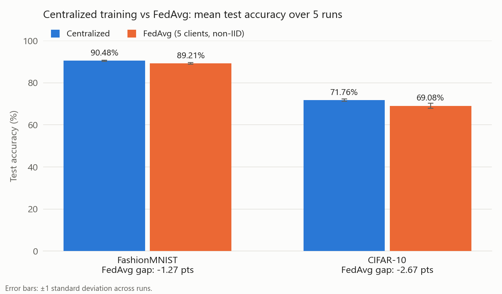

# Federated Averaging for Distributed Machine Learning

This project implements and evaluates the Federated Averaging (FedAvg) algorithm for distributed machine learning. It compares centralized model training with a federated setup using simulated clients, non-IID uneven data splits, and repeated experiments on FashionMNIST and CIFAR-10.

## Project Overview

The goal of this project is to understand how federated learning behaves when data is distributed across multiple clients rather than stored in one centralized dataset. The notebook simulates a server-client training workflow on a single machine:

1. The server initializes and broadcasts a global model.
2. Each client trains locally on its own data partition.
3. The server aggregates local model weights using FedAvg.
4. The global model is evaluated after each communication round.
5. Results are compared against centralized baseline training.

## Main Experiments

- Q1: Centralized baseline training on FashionMNIST
- Q2: FedAvg with 5 simulated clients on FashionMNIST
- Q3a: Centralized baseline training on CIFAR-10
- Q3b: FedAvg with 5 simulated clients on CIFAR-10
- Cross-dataset comparison of baseline and federated performance

## Key Technical Details

- Simulates 5 clients through iterative local training
- Uses non-IID uneven client splits based on Dirichlet distribution
- Aggregates client models by weighted averaging, proportional to client dataset size
- Tracks per-client training accuracy and server-side validation/test accuracy
- Repeats experiments 5 times to report mean accuracy and variance

## Results Summary



Mean test accuracy over 5 runs (variance in parentheses):

| Dataset | Centralized baseline | FedAvg, 5 non-IID clients | Gap |
|---|---|---|---|
| FashionMNIST | 90.48% (0.0429) | 89.21% (0.1173) | -1.27 pts |
| CIFAR-10 | 71.76% (0.2870) | 69.08% (1.2891) | -2.67 pts |

- FedAvg stays close to centralized training on both datasets, but never matches it.
- The gap is wider on CIFAR-10, the harder dataset, and FedAvg results vary more from run to run there, which reflects the uneven, non-IID client data.

## Files

- `Final_Project_Code.ipynb`: full implementation and experiment notebook
- `Final_Project_Report.html`: rendered report with experiment outputs and plots
- `requirements.txt`: Python dependencies used by the notebook
- `docs/accuracy_comparison.png`: chart of the results above

Large local datasets are intentionally excluded from the repository. The notebook downloads FashionMNIST and CIFAR-10 through `torchvision.datasets` when executed.

## Tech Stack

- Python
- PyTorch
- Torchvision
- NumPy
- Matplotlib
- Jupyter Notebook

## How To Run

Install dependencies:

```bash
pip install -r requirements.txt
```

Open the notebook:

```bash
jupyter notebook Final_Project_Code.ipynb
```

Then run the notebook cells in order. Dataset files will be downloaded locally into `./data`, which is ignored by Git.

## Portfolio Note

This project demonstrates distributed machine learning concepts, experimental design, model evaluation, and the implementation of a federated training loop from scratch using PyTorch.

## License

MIT
